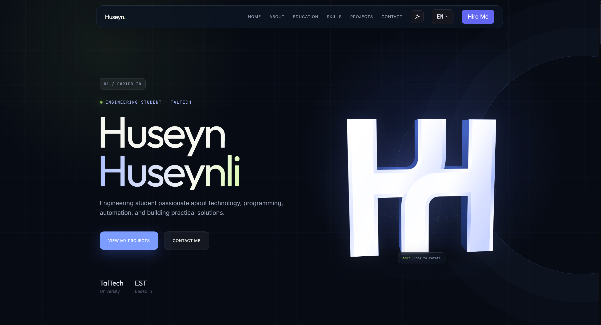

# 👋 Hi, I'm Huseyn Huseynli!

### 💻 Web Developer | Building for the Web

Welcome to my portfolio repository! I'm passionate about web development and creating modern, responsive, and user-friendly websites.

## 🌐 Live Portfolio

🚀 **Check out my website here:**

👉 [huseynhuseynli.vercel.app](https://huseynhuseynli.vercel.app)

## 📸 Portfolio Preview

## 🛠️ Technologies & Languages

- 🔷 **TypeScript** — 72.5%
- 🎨 **CSS** — 27%
- 🌐 **HTML** — 0.5%

## ✨ About This Project

This is my personal portfolio website, where I showcase my work, skills, and projects. My goal is to create engaging web experiences while continuing to learn and improve my development skills.

## 🎯 My Goals

- Build modern and responsive websites
- Improve my TypeScript and frontend development skills
- Create creative and useful projects
- Learn new technologies and tools
- Share my work with the developer community

## 📂 Source Code

Want to explore how my portfolio is built?

👉 [View the GitHub Repository](https://github.com/huseynhuseynliedu/Huseyn-s-portfolio)

## 📬 Connect With Me

- **GitHub:** [@huseynhuseynliedu](https://github.com/huseynhuseynliedu)
- **Portfolio:** [Visit my website](https://huseynhuseynli.vercel.app)

---

⭐ Thanks for visiting my profile and checking out my work!

**Made with ❤️ by Huseyn Huseynli**
